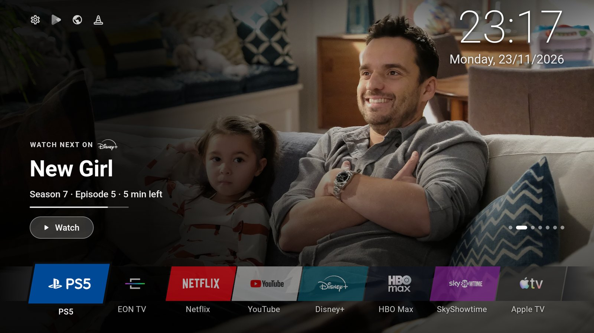

# TV Launcher

A minimal, Apple TV-style home screen for Android TV and Google TV, built on top of
**[Arc Launcher](https://github.com/meddouribadis/arclauncher)** by
[meddouribadis](https://github.com/meddouribadis).

The goal is a quiet home screen: one band of the apps you actually use, a full-screen
"Watch Next" banner above it, and nothing else. No ads, no recommendations rows, no
store tiles.



<sub>Home screen with the Watch Next banner showing an episode from Disney+.</sub>

> TV Launcher is a fork. Almost everything that makes it work — the Watch Next
> integration, the dock, wallpapers, settings and the overall architecture — comes from
> Arc Launcher and the projects it is based on. See [Credits](#credits).

## What is different from Arc Launcher

### Home screen

- **App band** across the whole width of the screen, near the bottom: one parallelogram
  per app, leaning 10°, with the app's name under it. A half tile at each screen edge
  fades out. The selected tile grows 15% and the others are dimmed. Right from the last
  app goes to the first, and Left from the first app goes to the last. Arc shows at most
  six apps in a row; the band fits as many apps as you add.
- **Flat tile colours.** Each tile shows the app's logo, up to 75% of the tile's height,
  on one flat colour taken from its banner. Gradients and glows behind the logo are
  removed. Netflix's white banner is shown as a red tile with a white logo.
- **The banner follows the band.** When the selection stays on an app for a moment, the
  Watch Next banner shows that app's first item, if it has one.
- **Immersive Watch Next banner** with a source badge that reads
  `WATCH NEXT ON <logo>`. Netflix, HBO, YouTube, Apple TV and SkyShowtime use bundled
  white logos; other apps use the foreground layer of their own icon, drawn in white.
  If an app has neither, the badge shows its name.
- **Top bar shortcuts** next to Settings and Wi-Fi: Play Store, a browser
  ([TV Bro](https://github.com/truefedex/tv-bro), falling back to the TV's built-in
  browser) and [VLC](https://www.videolan.org/vlc/download-android.html) for network
  drives. Each shortcut only appears when its app is installed.
- **Large two-line clock** in the top bar: the time in large, thin figures, with the
  date under it, e.g. `Friday, 20/11/2026`. The Wi-Fi glyph is off by default
  (Settings → Status bar turns it on).
- **Idle dim.** After 3 minutes without a key press, the top bar, the banner text and the
  band fade out and the picture darkens. The next key press only wakes the screen.

### Tiles

- **Custom app names**: hold OK on a tile → *Rename*. Leave the field empty to use the
  app's own name again. The band shows the new name, e.g. "EON TV" for "EON TV
  Slovenija".
- **Show the name of the selected app only**, like Apple TV, for the tiles in the app
  grid below the band (Settings → Interface → Miscellaneous). The band always shows its
  names.
- **Tile corner radius** for the app grid: 6, 12, 20 or 28 dp (Settings → Interface →
  Appearance).

### Speed and Home button

- **Apps open on the key press.** Arc waited for the press animation and a database
  write before starting the app (~170 ms); TV Launcher starts it immediately (~20 ms).
- **Home button service.** Google TV sends the remote's Home button to its own launcher
  even when another app is the default home app. An accessibility service replaces the
  stock home screen with TV Launcher whenever it appears, including after a reboot.
- **Home while TV Launcher is open** closes the settings panel and any dialog, scrolls
  back to the top and selects the first app in the band.

### Other

- New app ID `local.tvlauncher`, so it installs next to Arc Launcher.
- "Created by" footer in the settings menu.

## Building

Requirements:

- Flutter 3.41 (stable)
- JDK 17 (Gradle 8.13 does not run on newer JDKs)
- Android SDK with build-tools 36

```bash
flutter config --jdk-dir /path/to/jdk-17
flutter pub get
flutter test
flutter build apk --release --flavor github --split-per-abi
```

Most Google TV sets run a 32-bit userspace even on 64-bit chips. Check with
`adb shell getprop ro.product.cpu.abilist` and install the matching APK
(`app-armeabi-v7a-github-release.apk` or `app-arm64-v8a-github-release.apk`) from
`build/app/outputs/flutter-apk/`.

### Signing

Release builds are signed with the key named in `android/local.properties`, which is
git-ignored:

```properties
storeFile=/absolute/path/to/your.keystore
storePassword=...
keyAlias=...
keyPassword=...
```

Keep the keystore safe: Android only installs an update over an existing install if
it is signed with the same key.

### Personal build switches

Optional switches can go in a git-ignored `dart_defines.local.json` in the project
root and are passed at build time:

```json
{
  "HIDE_UNSPLASH_CREDIT": true
}
```

```bash
flutter build apk --release --flavor github --split-per-abi --dart-define-from-file=dart_defines.local.json
```

| Switch | Default | Effect |
| --- | --- | --- |
| `HIDE_UNSPLASH_CREDIT` | `false` | Hides the "Photo: … / Unsplash" credit on the wallpaper. Unsplash's API terms require the credit, so only use this for a build that stays on your own TV. |

## Installing and setting as Home

Enable wireless debugging on the TV (Settings → System → Developer options; the TV
must be on Wi-Fi), pair with `adb pair <ip>:<port>`, then:

```bash
adb install -r app-armeabi-v7a-github-release.apk
```

Let the Watch Next banner read what you are watching:

```bash
adb shell pm grant local.tvlauncher com.android.providers.tv.permission.READ_EPG_DATA
```

Make it the home app:

```bash
adb shell cmd package set-home-activity local.tvlauncher/com.omeda.arc.MainActivity
```

On Google TV that alone is not enough — Home still opens the stock launcher. Turn on
the Home button service:

```bash
adb shell settings put secure enabled_accessibility_services local.tvlauncher/com.omeda.arc.HomeButtonService
```

```bash
adb shell settings put secure accessibility_enabled 1
```

TCL TVs also block background services of sideloaded apps. If Home still opens the
stock launcher, allow TV Launcher to start in the background, then turn the service
off and on again:

```bash
adb shell appops set local.tvlauncher AUTO_START allow
```

```bash
adb shell appops set local.tvlauncher ACCESS_RESTRICTED_SETTINGS allow
```

To undo everything, point the home app back at the stock launcher and clear the
accessibility service:

```bash
adb shell cmd package set-home-activity com.google.android.apps.tv.launcherx/.home.HomeActivity
```

```bash
adb shell settings put secure enabled_accessibility_services null
```

Tested on a TCL Google TV (Android 14).

## Trademarks

Netflix, HBO, YouTube, Apple TV, SkyShowtime, Disney+ and other names and logos shown
in the Watch Next badge are trademarks of their respective owners. They are included
only to identify which app a show comes from. This project is not affiliated with or
endorsed by any of them.

## License

GPL-3.0, the same as Arc Launcher and FLauncher. See [LICENSE](LICENSE).

## Credits

TV Launcher stands on a chain of open-source launchers:

- **[Arc Launcher](https://github.com/meddouribadis/arclauncher)** by
  [meddouribadis](https://github.com/meddouribadis) — the direct base of this project.
  If you like TV Launcher, consider
  [supporting Arc Launcher's development](https://github.com/sponsors/meddouribadis).
- **[LTvLauncher](https://github.com/LeanBitLab/LtvLauncher)** by
  [LeanBitLab](https://github.com/LeanBitLab) — the base of Arc Launcher.
- **[FLauncher (fork)](https://github.com/osrosal/flauncher)** by
  [osrosal](https://github.com/osrosal) — community fork with additional features.
- **[FLauncher](https://gitlab.com/flauncher/flauncher)** by
  [etienn01](https://github.com/etienn01) — the original project.

The HBO, YouTube and Apple TV logo shapes come from [Simple Icons](https://simpleicons.org)
(CC0). The VLC cone in the top bar is based on Simple Icons' VLC shape.

The picture in the screenshot is a still from *New Girl*, supplied by the Disney+ app
through Watch Next. It belongs to its rights holders.

TV Launcher changes by [Nejc Furh](https://nejcfurh.dev).
